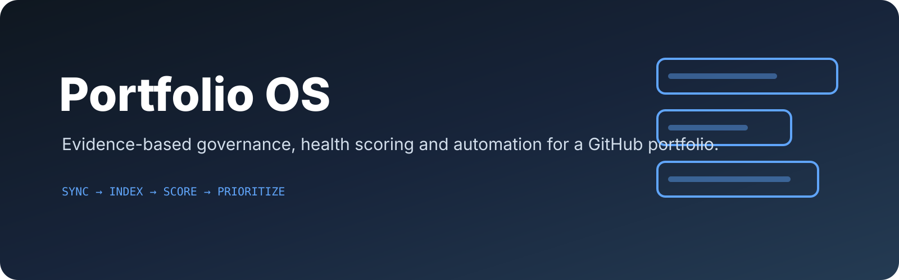

<p align="center">
  
</p>

# Portfolio OS

Private, evidence-based governance and automation for the `benclawbot` GitHub portfolio.

Portfolio OS synchronizes repositories, indexes GitHub activity, analyzes implementation evidence, scores portfolio health, detects duplicate components, models repository lineage, generates its own prioritized backlog and produces reports, documentation, dashboards and service-ready artifacts.

## Primary workflow

```bash
export GITHUB_TOKEN=github_pat_...
portfolio-refresh \
  --lineage-config config/portfolio.json \
  --policy portfolio-policy.example.json \
  --pretty
portfolio-workspace validate --pretty
```

The refresh pipeline runs:

1. safe GitHub synchronization and changed-repository analysis;
2. incremental branch, tag, release, issue, pull-request, status and check indexing;
3. portfolio reporting, intelligence scoring, history and knowledge-graph generation;
4. explicit repository-lineage and impact indexing;
5. exact cross-repository duplicate-component detection and shared-library recommendations;
6. evidence-backed prioritized backlog generation;
7. multi-period trend analysis;
8. changelog, release-note and architecture-document generation;
9. self-contained offline dashboard generation;
10. artifact cataloging and local operational telemetry;
11. optional policy enforcement.

Every run is protected by an exclusive workspace lock and recorded under `<workspace>/pipeline/runs/`.

## Commands

```bash
portfolio-os --help
portfolio-refresh --pretty
portfolio-github-index --pretty
portfolio-backlog --pretty
portfolio-artifacts catalog
portfolio-service jobs
portfolio-report --pretty
portfolio-trends --pretty
portfolio-dashboard --pretty
portfolio-policy --pretty
portfolio-ops runs --pretty
portfolio-workspace validate --pretty
portfolio-workspace repair-plan --pretty
```

## Repository analysis and documentation

```bash
python -m portfolio_os.cli analyze /path/to/repository --pretty
python -m portfolio_os.cli readme /path/to/repository --diff
python -m portfolio_os.cli readme /path/to/repository --write
python -m portfolio_os.cli dna /path/to/repository
python -m portfolio_os.cli compare /path/to/repo-a /path/to/repo-b --pretty
```

README generation is based on implementation evidence and preserves the existing leading hero banner.

## Safe synchronization

Missing repositories are cloned. Existing clean repositories may advance only through a fast-forward update on their checked-out default branch.

Portfolio OS never automatically:

- resets, rebases or cleans a repository;
- force-updates a branch;
- deletes branches or local repositories;
- overwrites dirty working trees;
- switches non-default branches.

Dirty trees, detached HEADs, other branches, archived repositories, origin mismatches, path conflicts and inaccessible repositories are preserved and reported.

## GitHub metadata index

Each refresh writes a portfolio manifest to `<workspace>/github/index.json` and one normalized artifact per repository under `<workspace>/github/repositories/`.

Indexed data includes:

- branches and protection state;
- tags and releases;
- issues and labels;
- pull requests and branch relationships;
- combined commit status and check runs for the default-branch head.

The index fingerprint uses repository identity, default branch, HEAD SHA, update timestamp, archive state and accessibility. Unchanged artifacts are reused. Indexing never changes managed checkouts.

## Intelligence and self-generated backlog

Each active repository receives explainable architecture, technical-debt, security and release-readiness scores. Every factor includes evidence, impact and confidence.

Portfolio OS also detects exact duplicate source components across repositories using normalized SHA-256 hashes and recommends shared libraries or templates when the same component appears in multiple projects.

Explicit inventory decisions are translated into lineage relationships such as `merge_into`, `migration_source_for`, `archive_candidate`, `reference_of` and `superseded_by`, with inbound and outbound impact indexes.

The resulting backlog contains stable IDs, evidence, impact, effort, risk, confidence, priority, acceptance criteria and verification plans.

```bash
portfolio-backlog --pretty
```

## Generated documents and dashboard

Generated outputs include:

```text
github/        normalized GitHub metadata
portfolio/     summary, Markdown report and knowledge graph
lineage/       merge, migration, archive and supersession relationships
reuse/         duplicate components and shared-library recommendations
backlog/       prioritized evidence-backed work queue
history/       immutable snapshots and latest delta
trends/        timelines, net changes, regressions and activity
documents/     generated changelog, release notes and architecture
telemetry/     local-only run and stage metrics
dashboard/     self-contained HTML and exact dashboard data
pipeline/      latest run and immutable run history
policy/        latest policy evaluation
artifacts/     catalog with IDs, types, sizes and SHA-256 digests
workspace/     validation manifest and repair plan
jobs/          durable pending, running, completed and failed jobs
```

The dashboard has no external scripts, fonts, trackers, CDN assets or network requests. It displays intelligence, backlog, duplication, lineage, trends, policy status and refresh history.

## REST API and durable jobs

Run the localhost service:

```bash
portfolio-service --workspace ~/.portfolio-os serve --host 127.0.0.1 --port 8765
```

Versioned endpoints:

```text
GET  /v1/health
GET  /v1/jobs
GET  /v1/jobs/{id}
POST /v1/jobs
POST /v1/jobs/run-next
GET  /v1/artifacts?path=<workspace-relative-path>
GET  /v1/artifacts/catalog
GET  /v1/artifacts/{artifact-id}
```

Supported durable jobs are `report`, `backlog`, `trends`, `documents` and `artifacts`.

## Artifact retention

Retention is plan-first and requires explicit confirmation:

```bash
portfolio-artifacts retention-plan --keep-history 30 --keep-runs 100 > retention.json
portfolio-artifacts apply-retention retention.json --confirm
```

Only immutable history snapshots and refresh-run records are eligible. Source repositories and current reports are never deleted by retention.

## Configuration profiles

Portfolio OS supports recursively merged named profiles selected with `PORTFOLIO_OS_PROFILE`. Workspace, GitHub, analysis and logging settings may be overridden per profile. Credentials remain environment-only.

See [`docs/CONFIGURATION.md`](docs/CONFIGURATION.md).

## Development and release verification

```bash
python -m pip install -e ".[dev]"
python -m compileall -q portfolio_os
python -m ruff check portfolio_os tests
python -m pyright portfolio_os
python -m pytest -q --cov=portfolio_os --cov-branch --cov-report=term-missing --cov-fail-under=90
python -m build
```

Stable releases are produced by the GitHub Actions **Release** workflow. It verifies version consistency, compilation, linting, type checking, tests, coverage, package installation and checksums before creating a tag and GitHub Release.

## Documentation

- [`docs/ANALYSIS-ENGINE.md`](docs/ANALYSIS-ENGINE.md)
- [`docs/README-GENERATOR.md`](docs/README-GENERATOR.md)
- [`docs/REPOSITORY-DNA.md`](docs/REPOSITORY-DNA.md)
- [`docs/KNOWLEDGE-GRAPH.md`](docs/KNOWLEDGE-GRAPH.md)
- [`docs/GITHUB-SYNC.md`](docs/GITHUB-SYNC.md)
- [`docs/INTELLIGENCE-AND-BACKLOG.md`](docs/INTELLIGENCE-AND-BACKLOG.md)
- [`docs/API-JOBS-AND-ARTIFACTS.md`](docs/API-JOBS-AND-ARTIFACTS.md)
- [`docs/CONFIGURATION.md`](docs/CONFIGURATION.md)
- [`docs/PORTFOLIO-REPORTING.md`](docs/PORTFOLIO-REPORTING.md)
- [`docs/PORTFOLIO-HISTORY.md`](docs/PORTFOLIO-HISTORY.md)
- [`docs/PORTFOLIO-TRENDS.md`](docs/PORTFOLIO-TRENDS.md)
- [`docs/PORTFOLIO-DASHBOARD.md`](docs/PORTFOLIO-DASHBOARD.md)
- [`docs/REFRESH-PIPELINE.md`](docs/REFRESH-PIPELINE.md)
- [`docs/PORTFOLIO-POLICY.md`](docs/PORTFOLIO-POLICY.md)
- [`docs/OPERATIONS-AND-VALIDATION.md`](docs/OPERATIONS-AND-VALIDATION.md)
- [`docs/RELEASING.md`](docs/RELEASING.md)
- [`CHANGELOG.md`](CHANGELOG.md)

Portfolio-level decisions remain machine-readable in [`config/portfolio.json`](config/portfolio.json).
